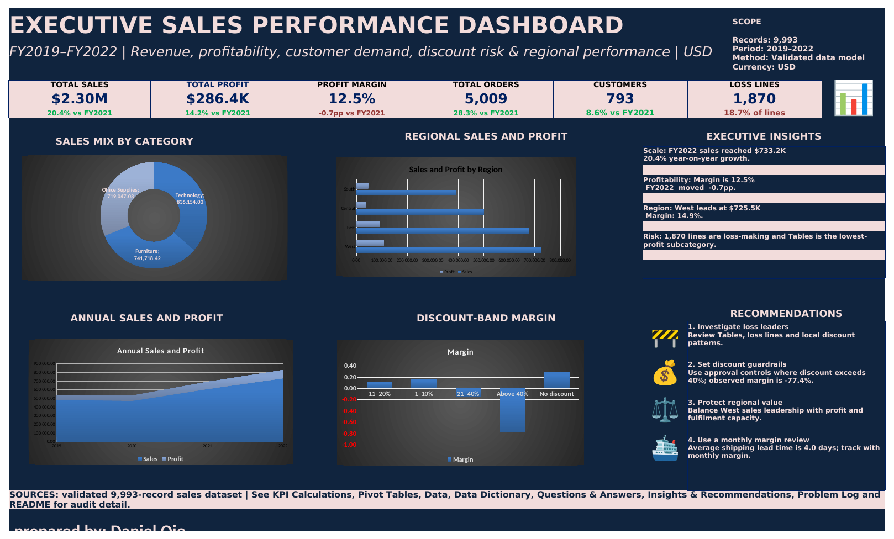
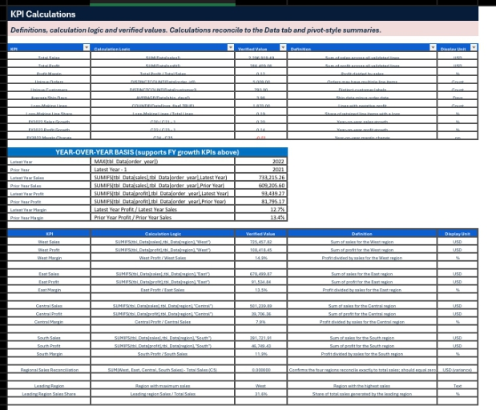
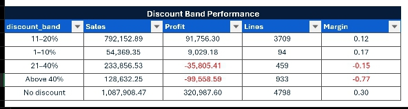
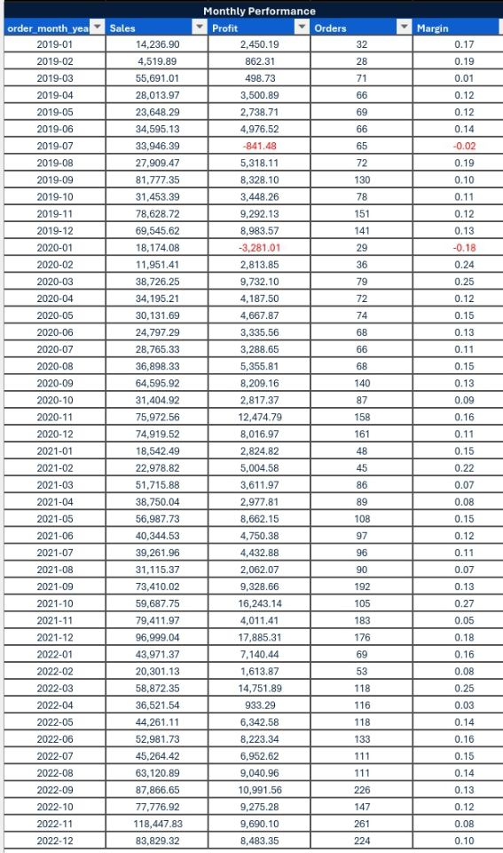
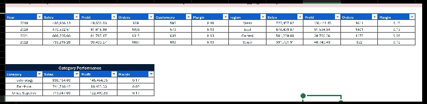

## Executive-Sales-Dashboard-
Executive sales dashboard built in Excel using validated transaction data, KPI calculations, profitability analysis, discount-risk controls, regional performance, and management recommendations.

## KPI Calculations Evidence

## Pivot Tables Evidence

## Author

Anuoluwapo Daniel Ojo — Software Engineer · Data · Finance

- GitHub: [github.com/Daniel38215571](https://github.com/Daniel38215571)
- LinkedIn: [linkedin.com/in/daniel-ojo-879273197](https://linkedin.com/in/daniel-ojo-879273197)
- Email: ojodaniel38@gmail.com
- Location: Lagos, Nigeria (Remote-ready)

Data × AI × Software. Building systems that prove themselves.
