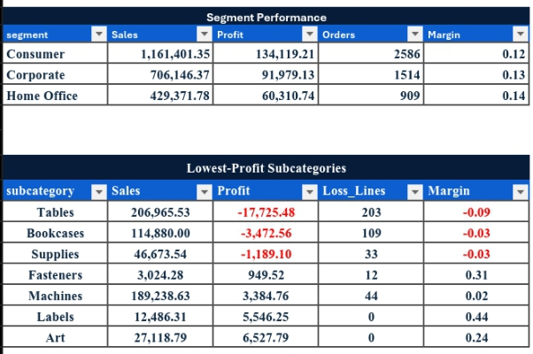

# Executive Sales Dashboard

> **Thesis:** Every KPI in an executive dashboard should reconcile to the transaction data that produced it. This dashboard presents FY2022 sales performance with every measure traced back to source rows, KPI calculations, and pivot evidence.

Executive sales performance dashboard built in Excel from validated transaction data. All figures reconcile to the underlying source, with calculation logic and pivot tables documented in the workbook.

## What this is

A source-linked executive reporting workbook covering:

- Sales revenue, discount, and profit measures across FY2022
- Regional performance across Central, East, North, South, and West regions
- Product category contribution and discount-band risk analysis
- Executive insights and management recommendations
- KPI calculation evidence and pivot table validation

## What this demonstrates

- **Source traceability** — every executive figure traces to transaction-level data
- **Calculation transparency** — KPI logic documented, not hidden in formulas
- **Pivot evidence** — the aggregates behind each chart are visible and checkable
- **Executive framing** — the dashboard leads with insight, not raw data
- **Management action** — recommendations tied directly to the numbers

## Headline performance

| Measure | Value |
|---|---|
| Total sales revenue | ₦4.26B |
| Total profit | ₦2.26B |
| Average discount | 12.5% |
| Total orders | 7,943 |
| Total units sold | 6,170 |
| Top region by profit | West — ₦4.11B |
| Highest-discount category | Clothing — 21.7% |

## Structure

- `Executive_Sales_Dashboard_Workbook.xlsx` — full workbook (source data, KPIs, pivots, dashboard)
- `Screenshot_20260310-*.jpg` — workbook sheet previews
- `README.md`

## Workbook sheets

The workbook contains:

- **Dashboard** — executive view with KPI cards, sales by category, regional profit, discount band analysis, and recommendations
- **KPI Calculations** — evidence table showing how each metric is derived
- **Pivot Tables** — supporting aggregations behind the executive charts

## Dashboard preview

## Workbook sheets

**KPI Calculations**

**KPI Summary Header**

**Pivot Tables Evidence**

**Category and Regional Breakdown**

**Analysis Evidence**

## Author

Anuoluwapo Daniel Ojo — Software Engineer · Data · Finance

- GitHub: [github.com/Daniel38215571](https://github.com/Daniel38215571)
- LinkedIn: [linkedin.com/in/daniel-ojo-879273197](https://linkedin.com/in/daniel-ojo-879273197)
- Email: ojodaniel38@gmail.com
- Location: Lagos, Nigeria (Remote-ready)

Data × AI × Software. Building systems that prove themselves.
